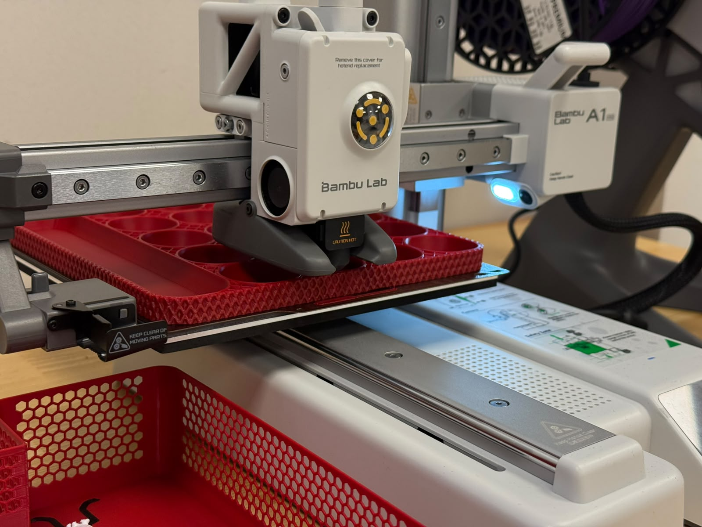

👉 | HEP 7: Start Melting Plastic
--- | ---
Authors | [@safaorhan](https://github.com/safaorhan)
Status | Active
Related PRs | [#41](https://github.com/konyahackerspace/heps/pull/41)
Related HEPs | -
Related Discussions | #37

## Introduction

This HEP proposes to buy our first 3d printer and a few spools of filament. 

## Pledging
This HEP accepts pledges. In the discussion #37 there are 11 upvotes to buy a 3d printer at the time of writing this, so let's [put out money where our mouth is](https://dictionary.cambridge.org/dictionary/english/put-money-where-mouth-is)! 😄 

| Donor | Amount |
| ---- | ---- |
| @safaorhan | 3000₺ |
| @mrabdullahsahin | 1000₺ |
| Hackerspace reserves | 17369.17₺ |
| `Collected Total` | 21369.17₺ |
| `Required Total` | 21369.17₺ |

## Bill of Materials
Actual prices paid in March 2026. The printer was paid by wire transfer for a discount. Filament prices had increased since this HEP was written, and black PETG was out of stock, so natural PETG was ordered instead.

|  \#  | Name | Each | Total
| ---- | ---- | ----- | ---- 
| 1 | Bambu Lab A1 Mini Combo  | 17863.25₺ | 17863.25₺
| 2 | Porima PLA Premium: Red, Purple | 702.24₺ | 1404.48₺
| 2 | Porima PLA: Black, White | 678.48₺ | 1356.96₺
| 1 | Porima PETG: Natural | 744.48₺ | 744.48₺
| - | `Total` | - | 21369.17₺

## In Use
The printer has been in active use in the space since March 2026.

## Possible Q/A

**Why BambuLab?**
Easy to operate, plug and play, high quality prints. Also we have a few members who have positive experience using Bambu Lab printers.

**Why A1 Mini?**
It's cheapest Bambu Lab printer, silent, light-weight, do not compromise much from quality, entry-level.

**Why A1 Mini Combo?**
Multicolor printing for an additional 5400₺ sounds like a good improvement to me. Multi-color printing enables prints like rfid cards and badges with text and increases our overall capabilities. If you think we should not get the combo but instead get the A1 mini only (without AMS) let's discuss in the comments.

**Why Porima?**
Porima is slightly more expensive than the cheapest filaments available. It's consistently of high quality. It has a lot color options. When we use cheap filament, we usually waste filament because the prints fail more often and we throw away prints more often. Sometimes even we have to clean clogs from nozzles or AMS. Life is too short to deal with low quality filament.
